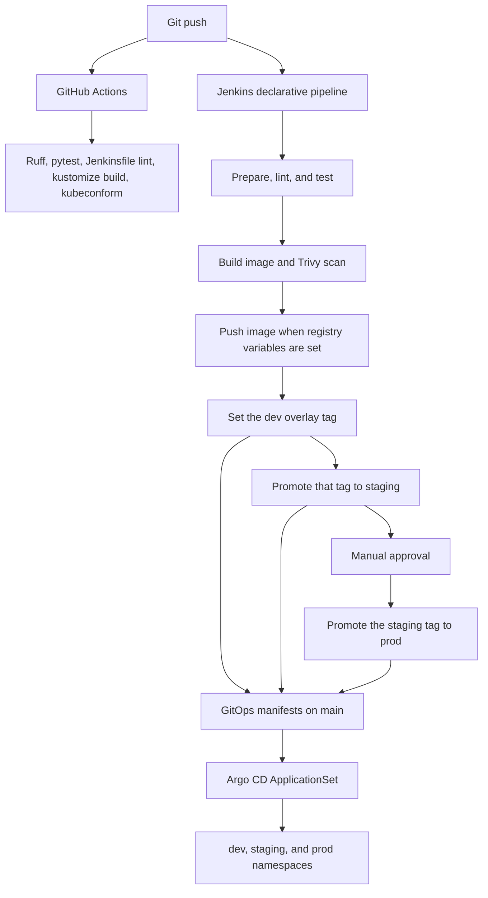

# Jenkins GitOps pipeline

Reference repository for a small Python service that Jenkins builds and promotes by changing image tags in Kustomize overlays. Argo CD manifests show how a cluster would read those tags. Nothing in this repo is deployed.

This is a portfolio demo for Arpan Bom. It is not a production platform. The Git remote, the container registry login, and the overlay tags are placeholders. There is no cluster, no registry credential, and no measured performance data.

## Architecture



The diagram is the intended flow. GitHub Actions runs only the checks in this repository. It does not push an image and does not apply manifests. The Jenkins push and Git steps print a placeholder line and stop when `REGISTRY_USER`, `REGISTRY_PASSWORD`, or `GITOPS_PUSH_URL` are unset.

## Layout

- `service/` is the FastAPI app `status-api`. Release tags live in process memory.
- `Jenkinsfile` is a declarative pipeline: lint, test, image build, Trivy scan, push, a GitOps tag bump, staging promotion, and a manual prod approval.
- `jenkins/` is Jenkins Configuration as Code, the plugin list, and the controller image.
- `docker-compose.yml` starts that controller on port 18080.
- `deploy/` is a Kustomize base plus dev, staging, and prod overlays.
- `argocd/` has one Application and an ApplicationSet. Apply one style, not both; both define `status-api-dev`.
- `scripts/promote.py` sets a tag or copies one along `dev` to `staging` to `prod`.
- `.github/workflows/ci.yml` runs the same checks on GitHub.

## Run the sample service

```bash
python3 -m venv .venv
source .venv/bin/activate
pip install -r service/requirements.txt
uvicorn status_api.main:app --app-dir service --host 127.0.0.1 --port 8000
```

`GET /health`, `GET /ready`, `GET /version`, and `GET /releases` are the HTTP routes. `PUT /releases/{environment}` updates one in-memory tag. The process does not read the Kubernetes ConfigMap, and the catalog resets when the process stops. FastAPI also serves `/docs` from the application object.

The service image is `service/Dockerfile`. This demo does not build or push it during the checks below.

## Run Jenkins locally

```bash
docker compose build
docker compose up
```

Open http://127.0.0.1:18080 and sign in as `admin`. The password defaults to `dev-only-change-me`. Override it with `JENKINS_ADMIN_PASSWORD`. That account exists only so the local setup wizard can be skipped.

Compose builds a controller, loads `jenkins/casc.yaml`, and registers a pipeline job. The job's Git URL is `https://github.com/PLACEHOLDER_ORG/jenkins-gitops-pipeline.git`, which is not a real remote. The controller image does not include Python, Docker, or Trivy, so the job cannot execute until an agent has those tools. This compose file does not start that agent and does not deploy `status-api`.

## Promote an image tag

```bash
python3 scripts/promote.py set --overlay dev --tag sha-example --dry-run
python3 scripts/promote.py promote --source dev --target staging --dry-run
python3 scripts/promote.py promote --source staging --target prod --dry-run
```

Allowed steps are `dev` to `staging`, then `staging` to `prod`. `--dry-run` prints the change and leaves the overlay files alone. `newTag` must be the only tag entry in each overlay, on its own line.

## Test

```bash
python3 -m venv .venv
source .venv/bin/activate
pip install -r service/requirements.txt -r requirements-dev.txt
make test
```

`make test` runs:

- `python3 -m ruff check service scripts tests`
- `python3 scripts/lint_jenkinsfile.py`
- `python3 -m pytest`
- `./scripts/validate_manifests.sh`

The Jenkinsfile check is structural. It confirms the declarative `pipeline` block, the agent, the required stages, the prod `input` gate, and the `scripts/promote.py` commands. It does not call Jenkins. A controller with the Pipeline: Model Definition plugin can validate the DSL through its converter endpoint; this repo does not start Jenkins in CI.

`scripts/validate_manifests.sh` downloads Kustomize 5.8.3 and kubeconform 0.8.0 into `.tools/` on first use, renders the base and each overlay, and checks them with kubeconform against the Kubernetes 1.37.0 schemas. Linux and macOS, amd64 and arm64, are the supported hosts for that download.

GitHub Actions runs `make test` from `.github/workflows/ci.yml`. Actions are not executed in this workspace.

## Placeholders

- Overlay tags `0.1.0-dev`, `0.1.0-staging`, and `0.1.0-prod` are not releases.
- CPU and memory figures on the Deployment are illustrative starting values, not measurements.
- `REGISTRY_USER`, `REGISTRY_PASSWORD`, and `GITOPS_PUSH_URL` are unset on purpose. The pipeline says so and does not push.
- Argo CD `repoURL` and the Jenkins job remote use `PLACEHOLDER_ORG`.

## License

MIT. See [LICENSE](LICENSE).
